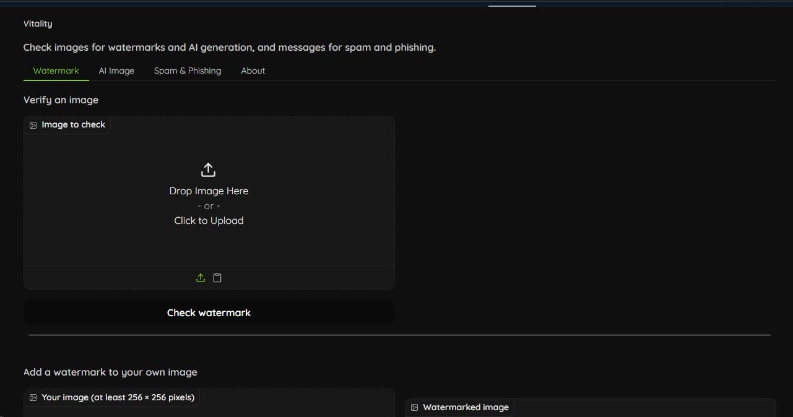
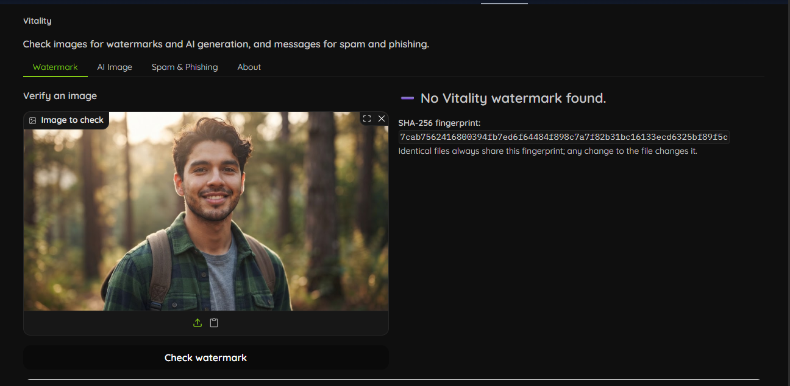
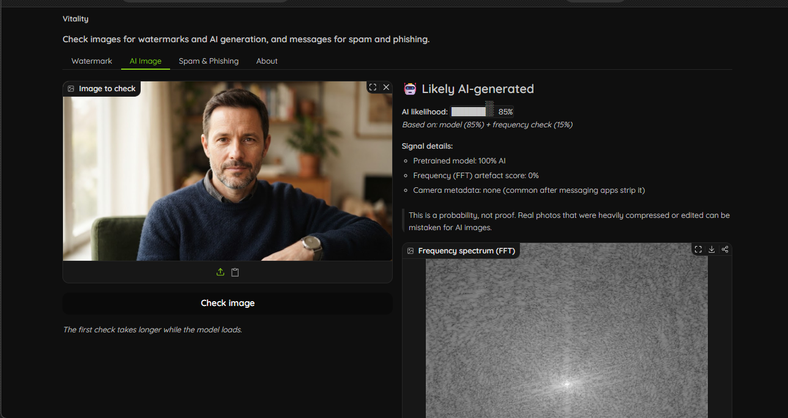
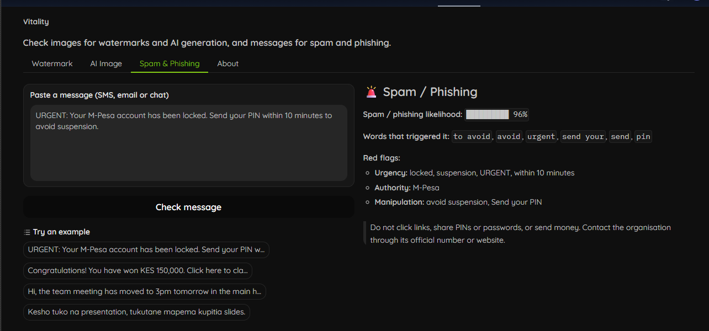
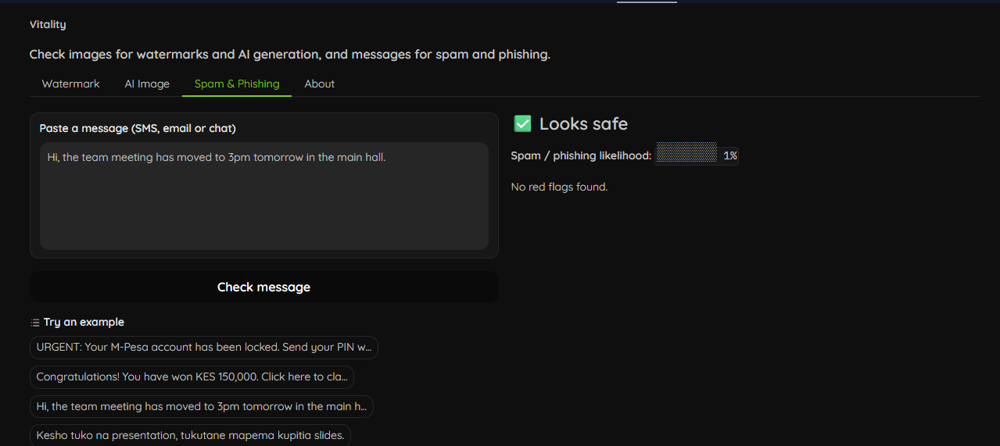

# Vitality — Detection System

Vitality is a web app that helps people check digital content before they trust it. It has three detectors:

**Watermark** : Whether an image carries an authentic, untampered Vitality watermark (signed with HMAC-SHA256), and whether it carries the hidden watermark Stable Diffusion adds to AI images. It can also add a signed watermark to your own images.
**AI image** : How likely an image is to be AI-generated, combining evidence in the file, a pretrained model and a frequency (FFT) check.
**Spam & Phishing** : Whether a message (SMS, email or chat) is likely spam or phishing, which words triggered the verdict, and which red flags it contains.

**Need a demo guide or test??** CHECK : https://huggingface.co/spaces/R1532/Vitality

Results are **probabilities, not proof**.

Built by **Reuben Vitalis** as the capstone project of the **Wecncode AI in Cybersecurity Bootcamp** (2026).



---

## How each detector works

### Watermark (cryptography)
1. A 20-byte message is hidden in the image's frequency patterns using a DWT-DCT-SVD transform (`invisible-watermark`). The change is invisible: image quality stays around 36–39 dB PSNR.
2. The message holds a marker, the date, a 1–3 character owner tag and a **48-bit HMAC-SHA256 signature** made with a secret key, so only the key holder can create valid watermarks.
3. **Reed–Solomon error correction** (as used in QR codes) repairs bits damaged by compression.
4. The watermark is embedded at a fixed working size (512 px), so resized copies can still be read.
5. Verification returns **authentic** (valid signature), **forged** (watermark present but signature invalid) or **none**, plus the file's **SHA-256 fingerprint**.



### AI image
| Signal | Weight |
|---|---|
| Evidence in the file: AI-tool names in metadata, Stable Diffusion prompts in PNGs, C2PA content credentials, the Stable Diffusion invisible watermark | If found: 99% AI |
| Pretrained model [`Organika/sdxl-detector`](https://huggingface.co/Organika/sdxl-detector) (Swin transformer, 98.1% validation accuracy on SDXL images) | 85% |
| FFT frequency check for grid-like upsampling artefacts | 15% |

Missing camera EXIF is deliberately **not** treated as evidence of AI, because messaging apps strip EXIF from real photos.



### Spam & Phishing
- **Model:** Logistic Regression on TF-IDF word (1–2 words) and character (3–5 letters) features.
- **Data:** 644 labelled messages (336 spam/phishing, 308 safe) in English, Swahili and Sheng, including M-Pesa-style scams.
- **Red flags:** rule-based checks for **urgency**, **authority** and **manipulation** phrases.





## Algorithms used

### Spam & Phishing detector — TF-IDF + Logistic Regression
1. **Text cleaning:** the message is lower-cased so "WIN" and "win" count as the same word.
2. **TF-IDF features:** the text is turned into numbers with *Term Frequency–Inverse Document Frequency*. A word or phrase scores high when it appears often in this message but rarely across all messages, so words like "the" score low and words like "congratulations" or "PIN" score high. Two views are combined:
   - **word features** – single words and two-word phrases (e.g. "send money", "account suspended");
   - **character features** – 3–5 letter fragments, which catch misspellings and tricks such as "fr33" or "M-PESA" written in different ways, and work across English, Swahili and Sheng.
3. **Logistic Regression:** each feature has a learned weight. The weighted sum is passed through the sigmoid function, which turns it into a probability between 0 and 1 that the message is spam or phishing. The model uses regularisation (C = 5) so it does not over-fit the 644 training messages.
4. **Explanation:** the words with the largest weight × TF-IDF values are shown as the words that triggered the verdict.
5. **Red flags:** a separate rule-based check looks for phrases of urgency ("act now"), authority ("Safaricom", "KRA") and manipulation ("you have won").

Logistic Regression was chosen after comparing eight algorithms; it had the best 5-fold cross-validation accuracy (92.4%), is fast, and its weights can be explained.

### Watermark detector — DWT-DCT-SVD, HMAC-SHA256, Reed–Solomon, SHA-256
- **DWT-DCT-SVD embedding:** the image is split into frequency bands with the *Discrete Wavelet Transform*, small blocks are transformed with the *Discrete Cosine Transform*, and each bit is hidden by slightly changing the block's largest value from *Singular Value Decomposition*. The change is invisible but survives compression.
- **HMAC-SHA256:** the message is signed with a secret key (signature shortened to 48 bits), so a watermark without the right key shows as **forged**.
- **Reed–Solomon error correction:** extra check bytes let the detector repair bits damaged by JPEG compression or resizing.
- **SHA-256:** produces a unique fingerprint of the uploaded file.

### AI-image detector — Swin Transformer + Fast Fourier Transform
- **Metadata checks:** rules that look for AI-tool names, Stable Diffusion prompts, C2PA content credentials and the Stable Diffusion invisible watermark.
- **Swin Transformer** (`Organika/sdxl-detector`): a vision transformer that splits the image into patches and compares them in shifting windows, then outputs the probability that the image is AI-generated.
- **Fast Fourier Transform (FFT):** converts the image into its frequency spectrum. Regular bright peaks away from the centre suggest the up-sampling grids used by AI image generators.
- **Weighted score:** model 85% + FFT 15%; if metadata evidence is found, the result is set to 99% AI.

---

## Results

| Detector | Test | Result |
|---|---|---|
| Spam & Phishing | 5-fold cross-validation | **92.4% accuracy**, 91.2% precision, 94.6% recall |
| Spam & Phishing | Held-out 20% (129 messages) | 93.8% accuracy: 64 scams caught, 3 missed, 5 false alarms |
| Watermark | JPEG 70–90, resize to 75%, messaging-app style resize + JPEG | Survives on normal photos (≥1000 px) |
| Watermark | Unmarked images / wrong key | Correctly "none" / "forged" |
| AI image | 18 labelled images (12 AI, 6 real) from the Week 9 lab | 13/18 (72%) at a 50% cut-off; strong on AI images (10/12), weak on real photos (3/6) |

Model comparison for spam (5-fold CV accuracy): Logistic Regression 92.4%, Linear SVM 91.9%, Multinomial NB 91.5%, Complement NB 91.1%, Random Forest 90.2%, k-NN 90.1%, SGD 88.5%, Gradient Boosting 83.7%.

## Limitations and future work
- The AI-image model gives **false alarms on some real photos**, especially compressed or edited ones. Planned: a second model ensemble, calibrated thresholds and a larger local test set.
- The FFT check rarely fires on JPEGs, because compression removes the artefacts it looks for.
- Watermarks survive compression and resizing but **not cropping**, and are weaker on small images (under ~600 px).
- The spam model is trained on 644 messages; more data, especially recent local scams, would improve it. A fine-tuned transformer is a future option.

---

## Run it locally (Windows)

```powershell
git clone https://github.com/reuben-vitalis/Vitality.git
cd Vitality
python -m venv .venv
.venv\Scripts\activate
pip install -r requirements.txt
copy .env.example .env          # then put a long random secret in WATERMARK_KEY
python -m training.train_spam   # trains models/spam_model.joblib
python app.py                   # open http://127.0.0.1:7860
```

Run the tests with `python -m pytest -q`.

## Project structure

```
app.py                  Gradio frontend (tabs)
detectors/watermark.py  HMAC-signed invisible watermark: embed + verify
detectors/ai_image.py   AI-image detector: evidence + model + FFT
detectors/spam.py       Spam & Phishing detector + red flags
training/train_spam.py  Trains and evaluates the spam model
data/spam.csv           644 labelled messages
models/                 Trained spam model
tests/                  pytest tests
```

## Credits and licences
- AI-image model: [`Organika/sdxl-detector`](https://huggingface.co/Organika/sdxl-detector), licensed **CC-BY-NC-3.0** (non-commercial, educational use).
- Watermarking: [`invisible-watermark`](https://github.com/ShieldMnt/invisible-watermark); error correction: `reedsolo`.
- Built with Gradio, scikit-learn, PyTorch and Hugging Face Transformers.
